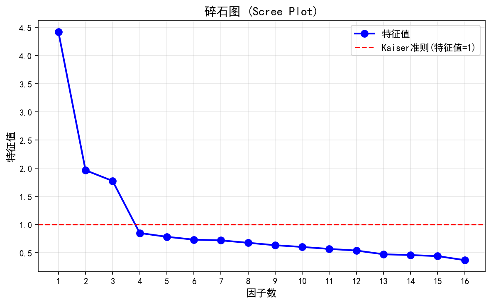
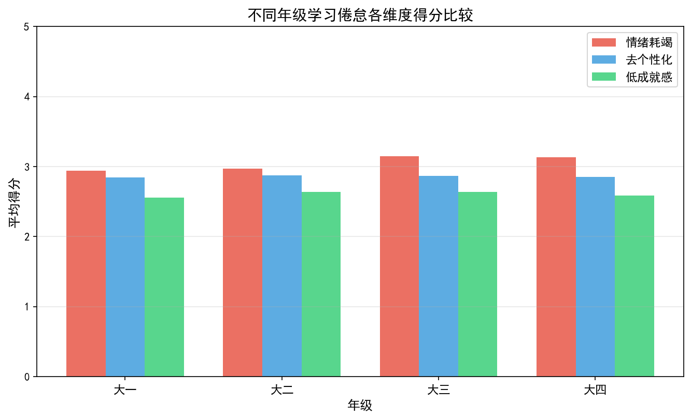
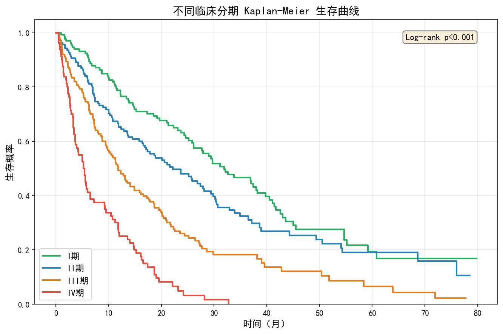
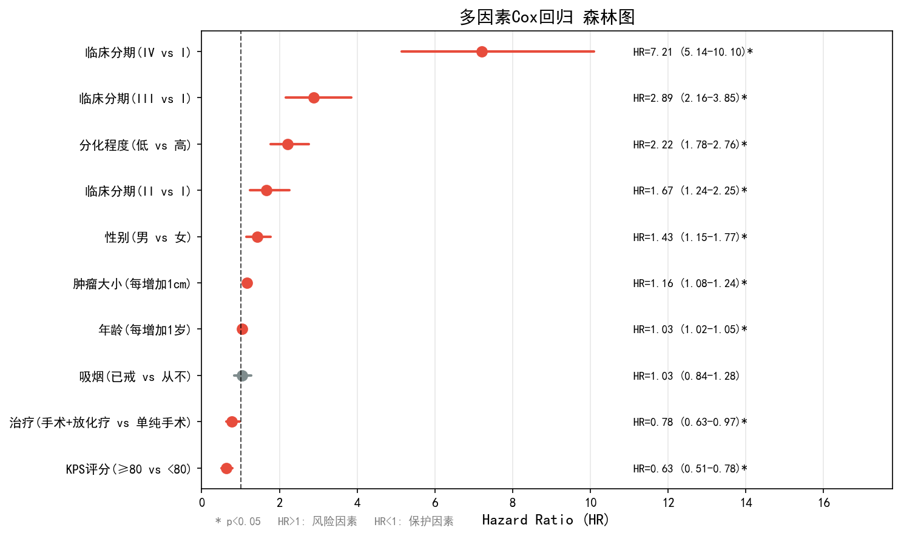
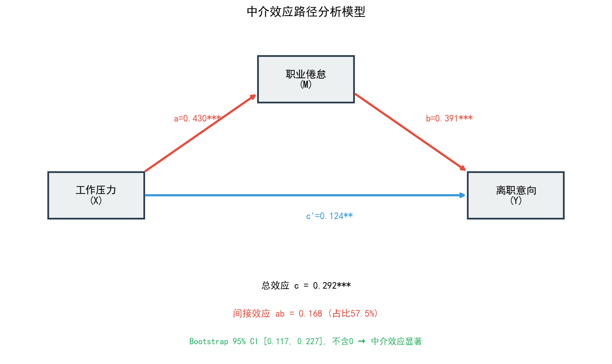
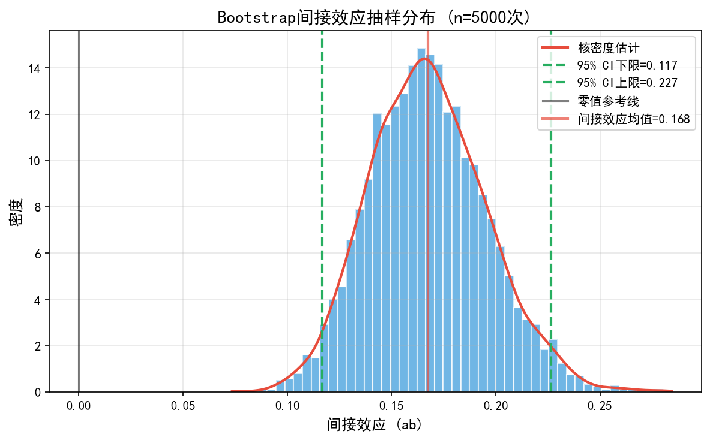

# 📊 Data Analysis Portfolio

> Three end-to-end statistical case studies in Python: from data to modelling, figures and an auto-generated Word report.
> 三个完整的统计分析案例：数据 → 建模检验 → 可视化 → 自动生成 Word 报告。


| # | 项目 | 方法 | 产出 |
|---|---|---|---|
| 01 | [大学生学习倦怠量表 · 问卷分析](01-questionnaire-analysis) | 描述统计、Cronbach's α 信度、KMO / Bartlett、探索性因子分析、卡方交叉分析 | 6 张图 + Word 报告 |
| 02 | [肿瘤患者术后随访 · 生存分析](02-survival-analysis) | Kaplan–Meier 曲线、Log-rank 检验、单 / 多因素 Cox 回归、森林图 | 4 张图 + Word 报告 |
| 03 | [工作压力 → 职业倦怠 → 离职意向 · 中介效应](03-mediation-analysis) | 正态性检验、Pearson 相关、多元回归、Bootstrap 中介检验、路径图 | 5 张图 + Word 报告 |

> 数据说明：三个项目的数据均由脚本按设定的分布**模拟生成**（固定随机种子，可完全复现），用于演示分析流程，不对应真实个人。

---

## 01 · 问卷数据分析：学习倦怠量表

300 份模拟问卷。检验量表信度与结构效度，并按年级、性别做差异分析。

<table><tr>
<td width="50%"></td>
<td width="50%"></td>
</tr></table>

## 02 · 生存分析：NSCLC 术后随访

500 例模拟随访数据。比较不同临床分期、治疗方式的生存差异，并用 Cox 回归找出独立预后因素。

<table><tr>
<td width="50%"></td>
<td width="50%"></td>
</tr></table>

## 03 · 中介效应：工作压力与离职意向

400 份模拟员工数据。检验「职业倦怠」在「工作压力 → 离职意向」之间的中介作用（Bootstrap 置信区间）。

<table><tr>
<td width="50%"></td>
<td width="50%"></td>
</tr></table>

---

## 运行

```bash
pip install -r requirements.txt
python 01-questionnaire-analysis/project1_questionnaire_analysis.py
python 02-survival-analysis/project2_survival_analysis.py
python 03-mediation-analysis/project3_mediation_analysis.py
```

每个脚本会在自己的文件夹里重新生成数据（CSV）、图表（PNG）和 Word 分析报告。图表中文字体使用 SimHei / 微软雅黑。

## 目录

```
01-questionnaire-analysis/   脚本 · 数据 · 图表 · 问卷数据分析报告_学习倦怠量表.docx
02-survival-analysis/        脚本 · 数据 · 图表 · 生存分析报告_NSCLC术后随访.docx
03-mediation-analysis/       脚本 · 数据 · 图表 · 中介效应分析报告_工作压力与离职意向.docx
```

## License

[MIT](LICENSE)
